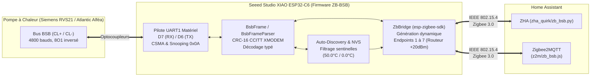
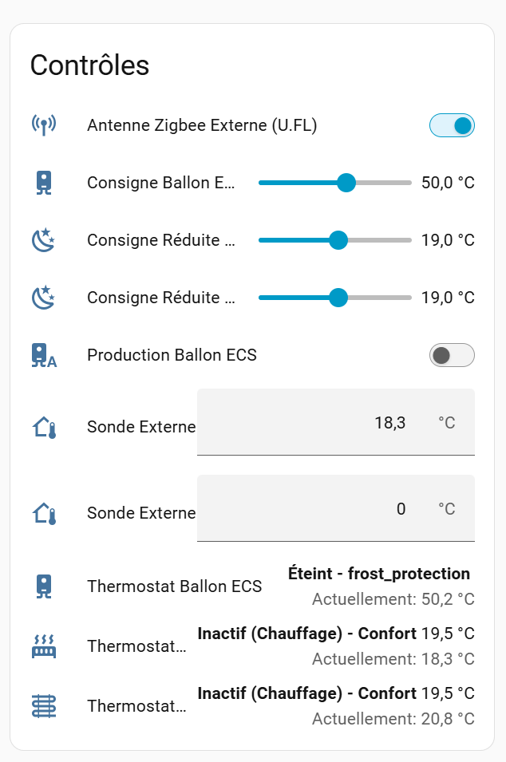
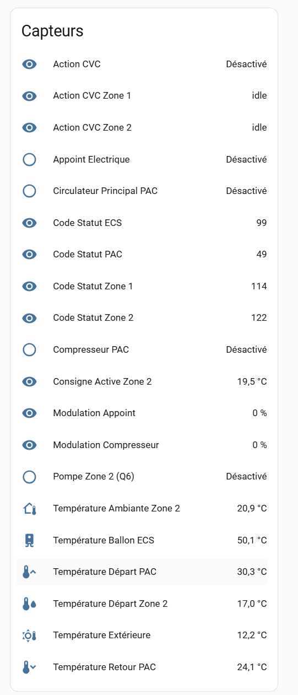
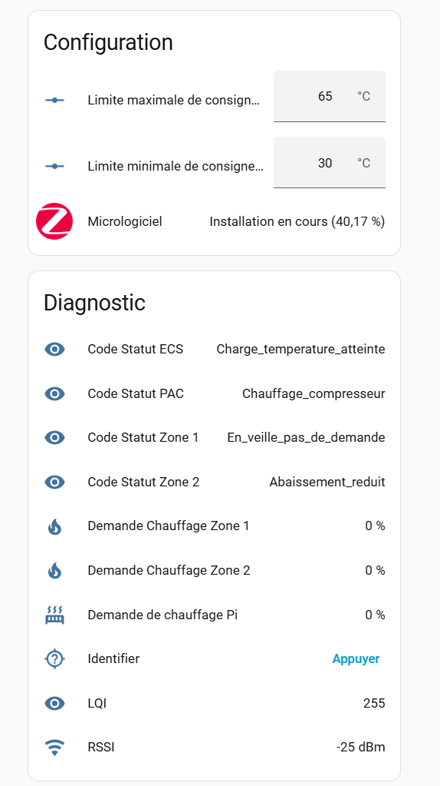
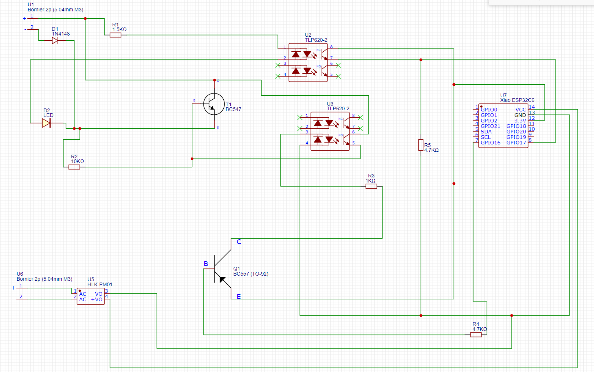
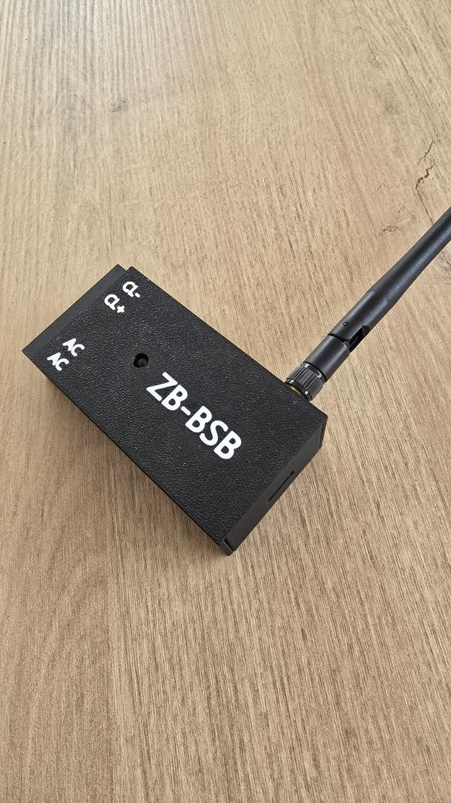

# ZB-BSB — Passerelle Zigbee 3.0 Autonome pour Pompe à Chaleur & Chaudière BSB

[](https://platformio.org/)
[-red?logo=zigbee)](https://csa-iot.org/)
[](https://www.home-assistant.io/)
[](LICENSE)

> **Language / Langue :** 🇬🇧 **[English (README.md)](README.md)** | 🇫🇷 **Français**

**ZB-BSB** est un firmware open-source écrit en C++ moderne pour le **Seeed Studio XIAO ESP32-C6**, permettant de superviser et piloter localement une pompe à chaleur ou chaudière équipée d'un bus **BSB (Boiler System Bus)** (*Atlantic Alféa Extensa / Excellia, Siemens RVS21 / RVS43 / RVS63, Chappée, De Dietrich, Elco...*) directement en **Zigbee 3.0** sous **Home Assistant** (**ZHA** et **Zigbee2MQTT**).

---

## Caractéristiques Principales

1. **Zéro Dépendance BSB Externe (`lib/bsb/`)** :
   - La pile protocolaire BSB est écrite intégralement de zéro en C++17/20 propre et documenté.
   - Aucune allocation dynamique (`malloc`/`std::vector`) dans l'automate de réception des trames (`BsbFrameParser`), garantissant une stabilité mémoire absolue 24h/24 et 7j/7.
2. **Coexistence Parfaite avec Cozytouch / Navilink (`0x0A`)** :
   - Intègre un mécanisme **CSMA d'évitement de collision** (détection de silence sur le bus et fenêtre de garde de `130 ms` lorsqu'un autre maître interroge la PAC).
   - **Snooping Passif** : écoute les réponses `RET` demandées par le pont radio officiel Cozytouch (`0x0A`) pour mettre à jour ses propres capteurs Zigbee sans dupliquer le trafic sur le bus.
3. **Auto-Découverte Matérielle & Persistance NVS** :
   - Au premier démarrage, **ZB-BSB** scanne automatiquement le bus BSB pour découvrir la topologie exacte de votre installation :
     - Modèle du régulateur (`6224`, ex: `RVS21.831F/127`) et type système (`6223`).
     - Présence de la **Zone 1** (ex: Radiateurs) et de la **Zone 2** (ex: Plancher chauffant sur module d'extension `AVS55`).
     - Détection intelligente des sondes physiquement câblées par **filtrage des valeurs sentinelles** (`50.0 °C` renvoyé lorsqu'une zone n'a pas de sonde d'ambiance filaire, `0.0 °C` lorsqu'une zone n'a pas de sonde de départ dédiée, ou octet d'état `flag_byte != 0x00`).
     - Présence d'un **Ballon ECS (DHW)** et d'un **Appoint Électrique**.
   - La topologie découverte est sauvegardée en mémoire non-volatile (**NVS**) : les redémarrages suivants sont instantanés et **seuls les Endpoints/Clusters Zigbee correspondant aux organes réellement présents** sont exposés au coordinateur.
4. **Routeur Zigbee 3.0 Haute Puissance (`+20 dBm`) & Switch Antenne Externe Dynamique** :
   - Alimenté en continu près de la pompe à chaleur, l'ESP32-C6 fonctionne en **Routeur Zigbee (`ZCZR`)** avec sa puissance d'émission poussée à **`+20 dBm`**, renforçant le maillage Zigbee de votre logement (garage, buanderie, sous-sol).
   - **Sélection d'antenne RF à chaud** : expose une entité `switch` Zigbee sur l'**Endpoint 7** permettant de basculer depuis Home Assistant entre l'antenne céramique SMD intégrée (**OFF**, par défaut) et une antenne externe branchée sur le connecteur **U.FL** (**ON**) sans recompiler le firmware (réglage sauvegardé en NVS).

---

## Architecture Logicielle



### Arborescence du Dépôt

```text
zb-bsb/
├── platformio.ini                   # Configuration PlatformIO (XIAO ESP32-C6 + environnement de tests natifs)
├── doc/
│   ├── gerber-zb-bzb.zip            # Archive des fichiers Gerber pour fabrication du PCB
│   ├── zb-bsb-enclosure_full.3mf    # Modèle 3D du boîtier à imprimer (.3mf)
│   └── screenshot/                  # Captures d'écran et photos matérielles
│       ├── control.png              # Carte Contrôles Home Assistant
│       ├── diag.png                 # Carte Diagnostic & OTA Home Assistant
│       ├── sensor.png               # Carte Capteurs Home Assistant
│       ├── schema-zb-bsb.png        # Schéma du circuit électronique
│       └── enclosure.jpeg           # Photo du boîtier imprimé en 3D terminé
├── include/
│   └── board_config.h               # Brochage matériel XIAO ESP32-C6 (D7/D6, LED, Bouton BOOT, Switch RF)
├── lib/
│   └── bsb/                         # Bibliothèque BSB autonome (0 dépendance externe)
│       ├── include/
│       │   ├── bsb_types.h          # Dictionnaire des Field IDs, types et tables de statut (FR)
│       │   ├── bsb_frame.h          # Sérialisation/Désérialisation trames BSB, CRC-16 XMODEM, automate RX
│       │   ├── bsb_bus.h            # Pilote UART1, anti-collision CSMA, snooping passif, file SET/GET
│       │   └── bsb_discovery.h      # Moteur d'Auto-Découverte PAC et persistance NVS
│       └── src/
│           ├── bsb_types.cpp
│           ├── bsb_frame.cpp
│           ├── bsb_bus.cpp
│           └── bsb_discovery.cpp
├── src/
│   ├── main.cpp                     # Point d'entrée, gestion bouton BOOT / LED et boucle principale
│   └── zigbee/
│       ├── zb_bridge.h              # Pont dynamique BSB <-> Zigbee 3.0
│       └── zb_bridge.cpp            # Construction dynamique des Endpoints ZCL, rapports unicast & callbacks
├── test/
│   └── test_bsb_protocol/
│       └── test_main.cpp            # Suite de tests unitaires Unity (CRC16, trames, bruit, sentinelles)
├── z2m/
│   └── zb_bsb.js                    # Convertisseur externe Zigbee2MQTT clé en main
└── zha_quirk/
    └── zb_bsb.py                    # Quirk personnalisé ZHA V2 (Préréglages Thermostat, Thermostat ECS & statuts)
```

---

## Brochage Matériel (Seeed Studio XIAO ESP32-C6)

Le bus BSB (`CL+` / `CL-`) utilise une signalisation différentielle basse vitesse à niveaux inversés nécessitant une interface à optocoupleurs (ex: `4N35` / `PC817`).

| Signal | Broche XIAO | GPIO ESP32-C6 | Rôle |
| :--- | :---: | :---: | :--- |
| **BSB RX** | **`D7`** | `GPIO17` | Entrée réception UART BSB (`4800 bauds, 8O1`) depuis le collecteur de l'optocoupleur RX (avec pull-up `3V3`) |
| **BSB TX** | **`D6`** | `GPIO16` | Sortie émission UART BSB (`4800 bauds, 8O1`) vers la LED de l'optocoupleur TX |
| **Alimentation** | **`5V` / `GND`** | — | Alimentation 5V continue (`>= 250 mA` recommandé, active le rôle **Routeur Zigbee 3.0**) |
| **LED Statut** | *Interne* | `GPIO15` | LED jaune programmable :<br>• **Clignotement (500 ms)** : Recherche / appairage Zigbee<br>• **Allumée fixe** : Associé et connecté au réseau Zigbee<br>• **Clignotement rapide (120 ms)** : Appui bouton 3 à 8s (Re-scan BSB)<br>• **Stroboscope (50 ms)** : Appui bouton > 8s (Reset Usine Zigbee) |
| **Bouton `BOOT`** | *Interne* | `GPIO9` | • Maintenir **3 à 8 s** : Relance une **Auto-Découverte BSB** complète<br>• Maintenir **> 8 s** : **Reset Usine Zigbee** + Effacement NVS + Redémarrage |
| **Switch Antenne RF** | *Interne* | `GPIO3` / `GPIO14` | Commutateur `FM8625H` pilotable dynamiquement depuis Home Assistant (**OFF** par défaut = antenne céramique interne, **ON** = antenne externe U.FL, sauvegardé en NVS) |

> [!TIP]
> Vous pouvez basculer à chaud entre l'antenne céramique SMD intégrée (**OFF**, par défaut) et une antenne externe branchée sur le connecteur **U.FL** (**ON**) directement depuis Home Assistant via le **Switch de l'Endpoint 7** sans recompiler le firmware. Le réglage est mémorisé en NVS et conservé après redémarrage ou mise à jour OTA.

---

## Comportement des LED et du Bouton Physique BOOT

### 1. Indicateurs LED du Seeed Studio XIAO ESP32-C6

La carte dispose de deux LED en surface :

| LED | Couleur | Contrôle | État | Signification |
| :--- | :---: | :--- | :--- | :--- |
| **LED Utilisateur** | **Jaune** | Logiciel (`GPIO15`) | **Clignotement régulier (500 ms)** | **En recherche de réseau / En appairage Zigbee** (attente d'ouverture du réseau ZHA / Zigbee2MQTT). |
| | | | **Allumée FIXE** | **Connecté et associé avec succès** au réseau Zigbee 3.0 (fonctionnement nominal). |
| | | | **Clignotement rapide (120 ms)** | Bouton `BOOT` maintenu entre **3 s et 8 s** (relâcher pour relancer l'Auto-Découverte). |
| | | | **Clignotement stroboscopique (50 ms)** | Bouton `BOOT` maintenu **> 8 s** (relâcher pour Reset Usine Zigbee). |
| **LED de Charge (`CHG`)** | **Rouge** | Matériel (ETA6003) | Allumée rouge fixe | Circuit matériel de charge batterie lithium via USB/5V (non pilotable par logiciel). |

### 2. Actions du Bouton Physique `BOOT` (GPIO 9)

Le petit bouton-poussoir `BOOT` situé sur la carte XIAO permet d'effectuer les opérations de maintenance sans ordinateur :

* **Appui court (< 3 secondes)** : Aucun effet (sécurité contre les faux contacts).
* **Maintien de 3 à 8 secondes (LED clignote rapidement)** : 
  * Relâchez le bouton : efface le cache de topologie NVS, relance un scan complet **Auto-Discovery** sur le bus BSB et redémarre la passerelle. Idéal après avoir raccordé une nouvelle sonde, un ballon ECS ou une extension Zone 2.
* **Maintien supérieur à 8 secondes (LED clignote en stroboscope)** :
  * Relâchez le bouton : effectue un **Reset Usine Zigbee complet** (quitte le réseau coordinateur, efface les clés d'appairage ZBOSS) + effacement NVS de la PAC + redémarrage en mode appairage neuf.

---

## Cartographie Dynamique des Endpoints Zigbee

Lors du premier démarrage, **ZB-BSB** interroge la PAC et n'active que les Endpoints correspondant à votre configuration matérielle :

| Endpoint | Condition d'activation | Clusters ZCL Standards | Entités Home Assistant (ZHA & Z2M) |
| :---: | :--- | :--- | :--- |
| **EP 1** | **Toujours actif** (Maître PAC + Zone 1) | • `Basic` (`0x0000`) : Modèle `ZB-BSB`, SW=`RVS21.831F/127`<br>• `Thermostat` (`0x0201`) : Mode (`Off`/`Auto`/`Heat`/`Sleep`), Confort (`710`), Réduit (`712`), État chauffe<br>• `TemperatureMeasurement` (`0x0402`) : **Temp. Extérieure (`8700`)**<br>• `BinaryInput` (`0x000F`) : **État Compresseur (`8400`)**<br>• `AnalogInput` (`0x000C`) : **Modulation Compresseur % (`8413`)**<br>• `AnalogOutput` (`0x000D`) : **Consigne Réduite Zone 1 (`712`)** | • Climate **Thermostat Zone 1**<br>• Sensor **Température Extérieure (°C)**<br>• Binary Sensor **Compresseur PAC**<br>• Sensor **Modulation Compresseur (%)**<br>• Number **Consigne Réduite Zone 1 (°C)** |
| **EP 2** | **Si Zone 2 détectée** (`1000` / `1010`) | • `Thermostat` (`0x0201`) : Mode (`1000`), Confort (`1010`), Réduit (`1012`), Ambiance (`8770`)<br>• `TemperatureMeasurement` (`0x0402`) : **Temp. Ambiante Zone 2 (`8770`)**<br>• `BinaryInput` (`0x000F`) : **Pompe Zone 2 Q6 (`8760`)**<br>• `AnalogInput` (`0x000C`) : **Code Statut Zone 2 (`8001`)**<br>• `AnalogOutput` (`0x000D`) : **Consigne Réduite Zone 2 (`1012`)** | • Climate **Thermostat Zone 2**<br>• Sensor **Température Ambiante Zone 2 (°C)**<br>• Binary Sensor **Pompe Zone 2 (Q6)**<br>• Sensor **Code Statut Zone 2**<br>• Number **Consigne Réduite Zone 2 (°C)** |
| **EP 3** | **Si Hydraulique Départ PAC ou Zone 1 présents** | • `TemperatureMeasurement` (`0x0402`) : **Temp. Départ PAC (`8412`)**<br>• `BinaryInput` (`0x000F`) : **Circulateur Principal PAC (`8406`) / Pompe Zone 1 Q2 (`8730`)**<br>• `AnalogInput` (`0x000C`) : **Code Statut PAC (`8006`)**<br>• `AnalogOutput` (`0x000D`) : **Sonde Temp. Externe Zone 1 (`0–35 °C`)** | • Sensor **Température Départ PAC (°C)**<br>• Binary Sensor **Circulateur Principal PAC / Pompe Zone 1**<br>• Sensor **Code Statut PAC (`8006`)**<br>• Number **Sonde Temp. Externe Zone 1 (°C)** |
| **EP 4** | **Si Hydraulique Retour PAC ou Zone 2 présents** | • `TemperatureMeasurement` (`0x0402`) : **Temp. Retour PAC (`8410`)**<br>• `AnalogInput` (`0x000C`) : **Code Statut Zone 1 (`8000`)**<br>• `AnalogOutput` (`0x000D`) : **Sonde Temp. Externe Zone 2 (`0–35 °C`)** | • Sensor **Température Retour PAC (°C)**<br>• Sensor **Code Statut Zone 1 (`8000`)**<br>• Number **Sonde Temp. Externe Zone 2 (°C)** |
| **EP 5** | **Si Sonde Départ Zone (`8773`/`8743`) présente** | • `TemperatureMeasurement` (`0x0402`) : **Temp. Départ Zone (`8773` / `8743`)**<br>• `AnalogInput` (`0x000C`) : **Consigne Active Zone 2 (`8771`)** | • Sensor **Température Départ Zone (°C)**<br>• Sensor **Consigne Active Zone 2 (°C)** |
| **EP 6** | **Si Ballon ECS (`8830`/`1610`) présent** | • `Thermostat` (`0x0201`) : **Thermostat Ballon ECS** (Mode `Off`/`Heat`, Consigne nominale `1610` 30–65 °C, Consigne réduite `1612`, État de chauffe active `8003`)<br>• `TemperatureMeasurement` (`0x0402`) : **Temp. Ballon ECS (`8830`)**<br>• `AnalogOutput` (`0x000D`) : **Consigne Ballon ECS (`1610`)**<br>• `OnOff` (`0x0006`) : **Activation Marche/Arrêt ECS (`1600`)**<br>• `AnalogInput` (`0x000C`) : **Code Statut ECS (`8003`)** | • Climate **Thermostat Ballon ECS (30–65 °C)**<br>• Sensor **Température Ballon ECS (°C)**<br>• Number **Consigne Ballon ECS (30–65 °C)**<br>• Switch **Marche/Arrêt ECS**<br>• Sensor **Code Statut ECS (`8003`)** |
| **EP 7** | **Toujours actif** (Auxiliaires & Switch Antenne RF) | • `BinaryInput` (`0x000F`) : **État Appoint Électrique (`8402`)**<br>• `AnalogInput` (`0x000C`) : **Modulation Appoint % (`8414`)**<br>• `TemperatureMeasurement` (`0x0402`) : **Temp. Ambiante Zone 1 (`8740`)** *(si sonde filaire BSB présente)*<br>• `OnOff` (`0x0006`) : **Switch Antenne Zigbee Externe U.FL (`GPIO14`)** | • Binary Sensor **Appoint Électrique**<br>• Sensor **Modulation Appoint (%)**<br>• Sensor **Température Ambiante Zone 1 (°C)** *(si filaire)*<br>• Switch **Antenne Zigbee Externe U.FL** (`OFF` par défaut) |

---

## Configurer une Sonde de Température Externe par Thermostat dans Home Assistant

Pour chaque zone de chauffage (**Thermostat Zone 1** et **Thermostat Zone 2**), **ZB-BSB** permet d'associer n'importe quelle sonde de température externe (Zigbee, Bluetooth, Matter, Wi-Fi, Netatmo, ex: `sensor.thermometre_temperature`) selon **2 méthodes au choix** :

### Méthode 1 — Depuis l'interface Home Assistant (Blueprint clé en main)
Chaque thermostat dispose d'une entité `number` dédiée :
- **`Sonde Temp. Externe Zone 1`** (exposée sur l'**Endpoint 3**)
- **`Sonde Temp. Externe Zone 2`** (exposée sur l'**Endpoint 4**)

1. Copiez le fichier [`homeassistant/zb_bsb_external_sensor_blueprint.yaml`](homeassistant/zb_bsb_external_sensor_blueprint.yaml) dans votre dossier `config/blueprints/automation/zb_bsb/` sur Home Assistant.
2. Dans **Paramètres → Automatisations et scènes → Blueprints**, cliquez sur **« ZB-BSB — Associer une Sonde de Température Externe à un Thermostat »** :
   - Sélectionnez votre **sonde de température Home Assistant** (ex: `sensor.thermometre_temperature`) dans la première liste déroulante.
   - Sélectionnez l'entité **`number` Sonde Temp. Externe Zone 1 (ou Zone 2)** dans la seconde liste déroulante.

### Méthode 2 — Par Binding Zigbee Direct (sans passer par Home Assistant)
Les **Endpoints 1 (Thermostat Zone 1)** et **2 (Thermostat Zone 2)** embarquent également un cluster client `TemperatureMeasurement` (`0x0402`). Vous pouvez donc lier (**Bind**) directement un thermomètre Zigbee vers l'Endpoint 1 ou 2 depuis l'interface ZHA ou Zigbee2MQTT.

### Fonctionnement interne côté PAC (BSB)
Dès qu'une température externe valide (`4.0 °C` à `38.0 °C`) est reçue pour une zone :
1. Elle met immédiatement à jour la température ambiante affichée sur la carte **Thermostat** correspondante dans Home Assistant (`LocalTemperature` + bit `RemoteSensing` activé).
2. Elle est diffusée sur le bus BSB vers le régulateur de la PAC via une trame **`INF`** (`0x2D3D051E` pour Zone 1, `0x2E3D051E` pour Zone 2), puis **automatiquement ré-émise toutes les 60 secondes** par l'ESP32-C6 pour que le régulateur Siemens RVS21 maintienne la régulation d'ambiance active.
3. **Watchdog de sécurité (30 minutes)** : si la sonde externe ne donne plus signe de vie pendant 30 minutes (ou si vous réglez l'entité `number` sur `0`), **ZB-BSB** repasse automatiquement sur la sonde filaire BSB de la PAC.

---

## Intégration dans Home Assistant

### Option A — ZHA (Zigbee Home Automation)
1. Copiez le fichier [`zha_quirk/zb_bsb.py`](zha_quirk/zb_bsb.py) dans `/config/zha_quirks/zb_bsb.py` et activez les quirks personnalisés dans votre `configuration.yaml` :
   ```yaml
   zha:
     enable_quirks: true
     custom_quirks_path: /config/zha_quirks
   ```
2. Redémarrez Home Assistant, puis ouvrez **Paramètres -> Appareils et services -> ZHA -> Ajouter un appareil**.
3. Alimentez le **XIAO ESP32-C6** raccordé à la PAC.
4. ZHA découvre automatiquement l'appareil **`Atlantic-Siemens ZB-BSB`** et crée les entités `climate` (Zone 1, Zone 2 et Ballon ECS avec préréglages Confort / Éco / Auto / Hors-gel), `sensor` (températures et états textuels traduits), `binary_sensor` et `switch`.

### Option B — Zigbee2MQTT
1. Copiez le fichier [`z2m/zb_bsb.js`](z2m/zb_bsb.js) dans le dossier `data/external_converters/` de votre instance Zigbee2MQTT.
2. Redémarrez Zigbee2MQTT et activez l'appairage (**Permit Join**).
3. En plus de tous les thermostats et capteurs, le convertisseur traduit automatiquement les codes statut numériques (`8000`, `8001`, `8003`, `8006`) en états texte en français.

---

## Aperçu de l'Appareil dans Home Assistant

Une fois appairé sous **ZHA** ou **Zigbee2MQTT**, la fiche de l'appareil **`Atlantic-Siemens ZB-BSB`** dans Home Assistant organise automatiquement toutes les entités découvertes au sein de trois cartes principales : **Contrôles**, **Capteurs** et **Configuration & Diagnostic**.

| Contrôles | Capteurs | Configuration & Diagnostic |
| :---: | :---: | :---: |
| [](doc/screenshot/control.png) | [](doc/screenshot/sensor.png) | [](doc/screenshot/diag.png) |

### 1. Carte Contrôles (`control.png`)
* **Thermostats (Climate)** :
  * **Zone 1 & Zone 2** : Pilotage indépendant des circuits de chauffage avec réglage des températures de consigne et sélection des modes (*Confort, Éco / Réduit, Auto, Hors-gel*).
  * **Ballon ECS** : Entité thermostat dédiée pour le contrôle de l'eau chaude sanitaire (plage 30–65 °C).
* **Consignes & Curseurs** : Curseurs interactifs pour régler rapidement la consigne nominale ECS ainsi que les consignes réduites de nuit pour chaque zone.
* **Injection de Sondes Externes (`number`)** : Champs numériques permettant d'injecter la température ambiante de n'importe quel thermomètre domotique (Zigbee, Matter, BLE, Wi-Fi...) directement sur le bus BSB pour la compensation d'ambiance.
* **Interrupteurs Matériels** :
  * **Production Ballon ECS** : Activation ou coupure de la chauffe du ballon d'eau chaude sanitaire.
  * **Antenne Zigbee Externe (U.FL)** : Bascule dynamique à chaud entre l'antenne céramique interne et une antenne externe à gain branchée sur le connecteur U.FL, sans recompiler ni flasher.

### 2. Carte Capteurs (`sensor.png`)
* **Températures en Temps Réel** :
  * **Température Extérieure** (`8700`), **Départ PAC** (`8412`) et **Retour PAC** (`8410`).
  * **Ambiance Zone 2** (`8770`) et **Départ d'eau Zone 2** (`8773`).
  * **Température Ballon ECS** (`8830`).
* **Organes de Chauffe & Capteurs Binaires** :
  * État en direct du **Compresseur PAC** (`8400`), de l'**Appoint Électrique** (`8402`), du **Circulateur Principal PAC** (`8406`) et de la **Pompe Zone 2 Q6** (`8760`).
  * **Action CVC** : Suivi de l'action active par zone (`idle`, `chauffage`).
* **Niveaux de Modulation & Consignes** :
  * **Modulation Compresseur (%)** (`8413`) et **Modulation Appoint (%)** (`8414`).
  * **Consigne Active de Départ** (`8771`) calculée en temps réel selon la loi d'eau.
* **Codes Statut Bruts BSB** : Valeurs numériques d'état transmises directement par le contrôleur Siemens (`8000`, `8001`, `8003`, `8006`).

### 3. Carte Configuration & Diagnostic (`diag.png`)
* **Mise à Jour Firmware Zigbee OTA en Direct** : Suivi en direct du téléversement et de l'installation du micrologiciel OTA avec barre de progression et pourcentage d'avancement (ex. `Installation en cours (40,17 %)`).
* **Diagnostics Décodés en Clair** : Traduction textuelle immédiate des états internes du régulateur pour chaque circuit :
  * Pompe à chaleur : ex. `Chauffage_compresseur`
  * Ballon ECS : ex. `Charge_temperature_atteinte`
  * Zones de chauffage : ex. `En_veille_pas_de_demande`, `Abaissement_reduit`
* **Demandes de Chauffage (%)** : Pourcentage calculé en temps réel de la demande de chauffe par zone et de la régulation PI.
* **Métriques Radio Zigbee & Maintenance** :
  * **LQI** (qualité de liaison jusqu'à 255) et **RSSI** (force du signal en dBm) en direct.
  * Bouton **Identifier** pour déclencher le clignotement stroboscopique de la LED du XIAO et repérer physiquement le boîtier.
  * Limites de consigne minimale et maximale configurables.

---

## Mises à Jour Firmware Zigbee OTA (`zha_toolkit`, GitHub Releases & Serveur Personnalisé)

**ZB-BSB** intègre nativement un client **Zigbee OTA Upgrade (`0x0019`)** sur l'**Endpoint 1**, appuyé sur une table à double partition OTA (`app0` / `app1` dans `zigbee_zczr.csv`) avec protection anti-brick par rollback automatique (`esp_ota_mark_app_valid_cancel_rollback()`).

À chaque compilation (`pio run` en local ou sur GitHub Actions), le script [`scripts/build_ota.py`](scripts/build_ota.py) génère automatiquement dans le dossier `ota/` :
- `ota/zb_bsb.ota` et `ota/zb_bsb_v<VERSION_HEX>.ota` — l'image Zigbee OTA standard (`Manufacturer = 0x131B / 4891`, `Image Type = 0x0001`).
- `ota/index.json` — le manifeste JSON contenant l'URL de téléchargement du `.ota`, `fileVersion` et l'empreinte `sha512`.

### Option 1 (Recommandée) — Tout builder et héberger sur GitHub via le Workflow Manuel (`workflow_dispatch`)
Le workflow GitHub Actions [`.github/workflows/ci.yml`](.github/workflows/ci.yml) intègre un job **`publish-ota`** (**Publish Zigbee OTA Release on GitHub**) à déclenchement manuel qui compile le firmware, génère le `.ota` + `index.json` et les héberge directement dans **GitHub Releases** :

1. Sur votre dépôt GitHub, ouvrez l'onglet **Actions → ZB-BSB CI & OTA Release → Run workflow**.
2. Saisissez la nouvelle version dans **`ota_version`** en hexadécimal (ex. `0x01020000` — strictement supérieure à la version en cours d'exécution sur l'ESP32-C6) puis cliquez sur **Run workflow**.
3. Dès que le job **`publish-ota`** est terminé, GitHub héberge automatiquement le manifeste de la dernière release à l'URL fixe permanente :
   ```text
   https://github.com/tom42530/zb-bsb/releases/latest/download/index.json
   ```
4. Dans le `configuration.yaml` de Home Assistant, déclarez une seule fois cette URL GitHub permanente dans `extra_providers` :
   ```yaml
   zha:
     enable_quirks: true
     custom_quirks_path: /config/zha_quirks
     zigpy_config:
       ota:
         otau_directory: /config/zigpy_ota
         extra_providers:
           - type: z2m
             url: https://github.com/tom42530/zb-bsb/releases/latest/download/index.json
   ```

### Option 2 — Compiler en local et héberger sur un serveur HTTP/HTTPS personnalisé
1. Dans [`platformio.ini`](platformio.ini), incrémentez `custom_ota_version` et renseignez l'URL de votre serveur dans `custom_ota_base_url` :
   ```ini
   custom_ota_version      = 0x01020000
   custom_ota_manufacturer = 0x131B
   custom_ota_image_type   = 0x0001
   custom_ota_hw_version   = 0x0001
   custom_ota_base_url     = https://ota.mon-domaine.fr/zb-bsb
   ```
2. Compilez le firmware :
   ```bash
   pio run -e seeed_xiao_esp32c6
   ```
   *(Optionnel)* Vous pouvez aussi régénérer à tout moment `ota/index.json` et le fichier `.ota` avec une autre URL ou version sans recompiler :
   ```bash
   python scripts/build_ota.py --base-url https://ota.mon-domaine.fr/zb-bsb --version 0x01020000
   ```
3. Déposez `ota/index.json` et `ota/zb_bsb_v01020000.ota` sur votre serveur web HTTP/HTTPS et renseignez `url: https://ota.mon-domaine.fr/zb-bsb/index.json` dans `extra_providers`.

### Installer la mise à jour OTA dans Home Assistant
1. Rechargez l'intégration **ZHA** (**Paramètres → Appareils et services → ZHA → ⋮ → Recharger**) pour rafraîchir le manifeste `index.json` depuis GitHub Releases.
2. Sur la fiche de l'appareil **`Atlantic-Siemens ZB-BSB`**, l'entité **Micrologiciel** (`update`) passe automatiquement à **Mise à jour disponible** — cliquez simplement sur **Installer** (ou appelez l'action `update.install` dans **Outils de développement → Actions**) :
   ```yaml
   action: update.install
   target:
     entity_id: update.atlantic_siemens_zb_bsb_micrologiciel
   ```
3. Pendant le téléchargement OTA, la barre de progression s'affiche en direct dans Home Assistant, la LED du XIAO clignote rapidement (`200 ms`), les rapports périodiques de capteurs sont suspendus pour maximiser le débit Zigbee et le bouton BOOT est verrouillé.
4. Une fois l'image vérifiée à 100 %, l'ESP32-C6 redémarre automatiquement sur la nouvelle partition.

---

## Compilation, Flash et Tests Unitaires

### 1. Compiler et flasher le firmware
```bash
# Compiler le firmware pour Seeed Studio XIAO ESP32-C6
pio run -e seeed_xiao_esp32c6

# Flasher en USB-C et ouvrir le moniteur série
pio run -e seeed_xiao_esp32c6 -t upload -t monitor
```

### 2. Exécuter la suite de tests unitaires (`Unity`)
Le projet inclut une suite complète de **13 tests unitaires** dans [`test/test_bsb_protocol/test_main.cpp`](test/test_bsb_protocol/test_main.cpp) couvrant :
- Le calcul **CRC-16 CCITT (XMODEM)** sur vecteurs standards et trames BSB réelles.
- La sérialisation des trames `GET`, `SET` (température et mode) et `INF` (broadcast) avec permutation des octets de poids fort du `field_id`.
- L'automate de réception `BsbFrameParser` (températures positives et négatives en complément à 2, snooping des trames `0x0A` Cozytouch, rejet des CRC corrompus, resynchronisation sur bruit de bus et longueurs invalides).
- Le filtrage des valeurs sentinelles pour l'**Auto-Discovery** (`50.0 °C` pour sonde d'ambiance absente, `0.0 °C` pour sonde départ absente).

```bash
# Exécuter les tests sur PC (environnement natif, également exécuté par GitHub Actions CI)
pio test -e native -v

# Vérifier la compilation des tests embarqués pour l'ESP32-C6
pio test -e seeed_xiao_esp32c6 --without-uploading --without-testing
```

---

## Conception du Circuit Électronique & Fabrication du PCB

Le pont **ZB-BSB** intègre une isolation optique complète et une alimentation secteur 230V autonome directement sur un PCB dédié, éliminant tout bloc d'alimentation USB externe et garantissant une isolation galvanique totale vis-à-vis de l'électronique de la pompe à chaleur.

<p align="center">
  <a href="doc/screenshot/schema-zb-bsb.png"></a>
</p>

### Ressources Disponibles au Téléchargement
* **Fichiers Gerber de Fabrication** : [`doc/gerber-zb-bzb.zip`](doc/gerber-zb-bzb.zip) — Archive prête à commander chez un fabricant de PCB (JLCPCB, PCBWay, AISLER...).
* **Schéma Électronique Haute Définition** : [`doc/screenshot/schema-zb-bsb.png`](doc/screenshot/schema-zb-bsb.png)

### Points Clés du Circuit
1. **Isolation Galvanique (Bus BSB)** :
   * **`U2` & `U3` (TLP620-2)** : Optocoupleurs doubles isolant la ligne de réception RX (`GPIO17` / `D7`) et la ligne d'émission TX (`GPIO16` / `D6`) de tout parasite ou surtension du bus BSB.
   * **Conditionnement par Transistors** : Étages de commutation `BC547` (NPN) et `BC557` (PNP) associés à des résistances de `1,5 kΩ`, `10 kΩ`, `1 kΩ` et `4,7 kΩ` pour des fronts de signaux 4800 bauds nets et inversés.
   * **Protection du Bus** : Diode `1N4148` (`D1`) protégeant contre toute inversion de polarité sur les bornes différentielles `CL+` / `CL-`.
   * **Témoin Visuel d'Activité** : LED rouge `D2` clignotant au rythme des échanges de trames sur le bus BSB.
2. **Alimentation Secteur 230V Intégrée (Autonome)** :
   * **`U5` (Hi-Link HLK-PM01)** : Convertisseur abaisseur AC-DC fournissant une tension 5V continue régulée (`600 mA` / `3 W`) directement aux broches `VCC` et `GND` du Seeed Studio XIAO ESP32-C6.
   * **Raccordement Direct à la PAC** : Se branche directement sur les borniers 230V de la pompe à chaleur via le bornier à vis `U6` (`AC AC`), sans chargeur secteur externe ni câble USB disgracieux.

### Nomenclature des Composants (BOM)

| Réf. Schéma | Composant / Valeur | Boîtier | Rôle / Description |
| :--- | :--- | :--- | :--- |
| **`U7`** | **Seeed Studio XIAO ESP32-C6** | Module SMD | Microcontrôleur & routeur Zigbee 3.0 |
| **`U5`** | **Hi-Link HLK-PM01** | Module PCB | Alimentation 230V AC vers 5V DC régulée |
| **`U2`, `U3`** | **TLP620-2** | DIP-8 | Optocoupleurs doubles (isolation galvanique) |
| **`T1`** | **BC547** | TO-92 | Transistor bipolaire NPN |
| **`Q1`** | **BC557** | TO-92 | Transistor bipolaire PNP |
| **`D1`** | **1N4148** | DO-35 | Diode de commutation rapide (protection polarité) |
| **`D2`** | **LED Rouge 3 mm / 5 mm** | Traversant | Témoin d'activité de communication BSB |
| **`R1`** | **1,5 kΩ** (1/4 W) | Axial | Résistance de conditionnement bus |
| **`R2`** | **10 kΩ** (1/4 W) | Axial | Résistance de conditionnement bus |
| **`R3`** | **1 kΩ** (1/4 W) | Axial | Résistance de commande de base |
| **`R4`, `R5`** | **4,7 kΩ** (1/4 W) | Axial | Résistances de polarisation et pull-up |
| **`U1`, `U6`** | **Borniers à vis 2p (pas 5,04 mm / 5,08 mm)** | M3 Traversant | Raccordements bus BSB (`CL+`/`CL-`) et secteur (`AC`/`AC`) |
| **Antenne** | **Pigtail U.FL vers SMA + antenne 2,4 GHz** | SMA Femelle | Antenne externe Zigbee à haut gain |

---

## Impression 3D du Boîtier

Un boîtier sur-mesure a été spécialement conçu pour accueillir le PCB complet, le Seeed Studio XIAO ESP32-C6, le module d'alimentation Hi-Link et les borniers à vis, tout en intégrant une fixation pour antenne externe.

<p align="center">
  <a href="doc/screenshot/enclosure.jpeg"></a>
</p>

### Modèle Téléchargeable
* **Fichier d'Impression 3D** : [`doc/zb-bsb-enclosure_full.3mf`](doc/zb-bsb-enclosure_full.3mf) — Projet 3MF pré-configuré, prêt à découper (Bambu Studio, OrcaSlicer, PrusaSlicer, Cura).

### Caractéristiques du Boîtier
* **Marquages en Relief Bicolores** : Inscriptions intégrées nettes pour repérer les entrées **`AC AC`** (alimentation secteur 230V), **`CL+ CL-`** (bus BSB) et le marquage **`ZB-BSB`**.
* **Fenêtre LED d'Activité** : Puits de lumière placé directement au-dessus de la LED rouge `D2` pour observer le trafic BSB boîtier fermé.
* **Port Antenne Externe** : Emplacement dédié pour visser solidement l'embase SMA de l'antenne Zigbee externe reliée en U.FL.
* **Accès Maintenance & USB-C** : Ouverture latérale permettant de raccorder le câble USB-C pour les opérations de flash initial ou de diagnostic série sans ouvrir le boîtier.

### Recommandations d'Impression
* **Matériau** : **PETG**, **ABS** ou **ASA** fortement recommandés par rapport au PLA pour une meilleure résistance thermique en buanderie ou dans le compartiment électrique de la PAC.
* **Hauteur de Couche** : `0,20 mm` (excellent compromis solidité / netteté des textes).
* **Remplissage** : `20 %` (Gyroid ou Grille).
* **Impression Bicolore** : Changement de filament sur les dernières couches supérieures (ex. texte blanc sur corps noir texturé) pour un rendu contrasté identique à la photo.

---

## Inspiration & Crédits

Ce projet est une implémentation indépendante qui s'est inspirée des travaux communautaires open-source autour du protocole BSB, notamment au niveau des correspondances des attributs et identifiants de paramètres (`field_id`).

---

## Licence

Ce projet est distribué sous licence **MIT**. Voir le fichier [LICENSE](LICENSE) pour plus de détails.
