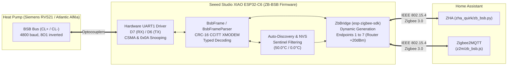

# ZB-BSB — Standalone Zigbee 3.0 Bridge for BSB Heat Pumps & Boilers

[](https://platformio.org/)
[-red?logo=zigbee)](https://csa-iot.org/)
[](https://www.home-assistant.io/)
[](LICENSE)

> **Language / Langue :** 🇬🇧 **English** | 🇫🇷 **[Français (README.fr.md)](README.fr.md)**

**ZB-BSB** is an open-source firmware written in modern C++ for the **Seeed Studio XIAO ESP32-C6**, enabling local monitoring and control of heat pumps and boilers equipped with a **BSB (Boiler System Bus)** interface (*Atlantic Alféa Extensa / Excellia, Siemens RVS21 / RVS43 / RVS63, Chappée, De Dietrich, Elco...*) directly over **Zigbee 3.0** in **Home Assistant** (**ZHA** and **Zigbee2MQTT**).

---

## Key Features

1. **Zero External BSB Library Dependency (`lib/bsb/`)**:
   - The BSB protocol stack is written from scratch in clean, documented C++17/20.
   - Zero dynamic memory allocation (`malloc`/`std::vector`) inside the frame reception state machine (`BsbFrameParser`), ensuring rock-solid 24/7 memory stability.
2. **Seamless Coexistence with Cozytouch / Navilink (`0x0A`)**:
   - Built-in **CSMA collision avoidance** (bus silence detection and a `130 ms` guard window whenever another master queries the heat pump).
   - **Passive Snooping**: listens to `RET` responses requested by the official Cozytouch radio bridge (`0x0A`) to update its own Zigbee attributes without duplicating bus traffic.
3. **Hardware Auto-Discovery & NVS Persistence**:
   - On first boot, **ZB-BSB** automatically scans the BSB bus to discover the exact topology of your installation:
     - Controller model (`6224`, e.g., `RVS21.831F/127`) and system type (`6223`).
     - Presence of **Zone 1** (e.g., Radiators) and **Zone 2** (e.g., Underfloor heating on an `AVS55` extension module).
     - Smart detection of physically wired sensors through **sentinel value filtering** (`50.0 °C` returned when a zone has no wired room sensor, `0.0 °C` when a zone has no dedicated flow sensor, or status byte `flag_byte != 0x00`).
     - Presence of a **Domestic Hot Water (DHW) Tank** and an **Electric Backup Heater**.
   - The discovered topology is saved in non-volatile memory (**NVS**): subsequent reboots are instantaneous, and **only the Zigbee Endpoints/Clusters matching physically present components** are exposed to the coordinator.
4. **High-Power Zigbee 3.0 Router (`+20 dBm`)**:
   - Continuously powered near the heat pump, the ESP32-C6 operates as a **Zigbee Router (`ZCZR`)** with its transmit power set to **`+20 dBm`** and its onboard RF antenna switch configured automatically, strengthening your home Zigbee mesh (garage, utility room, basement).

---

## Software Architecture



### Repository Structure

```text
zb-bsb/
├── platformio.ini                   # PlatformIO configuration (XIAO ESP32-C6 + native unit test environment)
├── include/
│   └── board_config.h               # XIAO ESP32-C6 hardware pinout (D7/D6, LED, BOOT button, RF switch)
├── lib/
│   └── bsb/                         # Standalone BSB library (zero external dependencies)
│       ├── include/
│       │   ├── bsb_types.h          # Dictionary of Field IDs, data types, and status tables
│       │   ├── bsb_frame.h          # BSB frame serialization/deserialization, CRC-16 XMODEM, RX parser
│       │   ├── bsb_bus.h            # UART1 driver, CSMA anti-collision, passive snooping, SET/GET queue
│       │   └── bsb_discovery.h      # Heat pump Auto-Discovery engine and NVS persistence
│       └── src/
│           ├── bsb_types.cpp
│           ├── bsb_frame.cpp
│           ├── bsb_bus.cpp
│           └── bsb_discovery.cpp
├── src/
│   ├── main.cpp                     # Entry point, BOOT button / LED management, and main loop
│   └── zigbee/
│       ├── zb_bridge.h              # Dynamic BSB <-> Zigbee 3.0 bridge
│       └── zb_bridge.cpp            # Dynamic ZCL Endpoint builder, direct unicast reporting & write callbacks
├── test/
│   └── test_bsb_protocol/
│       └── test_main.cpp            # Unity unit test suite (CRC16, frames, bus noise, sentinels)
├── z2m/
│   └── zb_bsb.js                    # Ready-to-use Zigbee2MQTT external converter
└── zha_quirk/
    └── zb_bsb.py                    # ZHA Custom Quirk V2 (Thermostat presets, DHW Thermostat & status enums)
```

---

## Hardware Pinout (Seeed Studio XIAO ESP32-C6)

The BSB bus (`CL+` / `CL-`) uses low-speed differential signaling with inverted logic levels, requiring an optocoupler interface (e.g., `4N35` / `PC817`).

| Signal | XIAO Pin | ESP32-C6 GPIO | Role |
| :--- | :---: | :---: | :--- |
| **BSB RX** | **`D7`** | `GPIO17` | BSB UART receive input (`4800 baud, 8O1`) from the RX optocoupler collector (with `3V3` pull-up) |
| **BSB TX** | **`D6`** | `GPIO16` | BSB UART transmit output (`4800 baud, 8O1`) to the TX optocoupler LED |
| **Power Supply** | **`5V` / `GND`** | — | Continuous 5V power supply (`>= 250 mA` recommended, enables **Zigbee 3.0 Router** role) |
| **Status LED** | *Internal* | `GPIO15` | Programmable yellow LED:<br>• **Regular blink (500 ms)**: Searching / pairing Zigbee network<br>• **Solid ON**: Joined and connected to the Zigbee network<br>• **Fast blink (120 ms)**: Button held 3 to 8s (BSB Re-scan)<br>• **Strobe blink (50 ms)**: Button held > 8s (Zigbee Factory Reset) |
| **`BOOT` Button** | *Internal* | `GPIO9` | • Hold **3 to 8 s**: Triggers a full **BSB Auto-Discovery** scan<br>• Hold **> 8 s**: **Zigbee Factory Reset** + NVS erase + Reboot |
| **RF Antenna Switch** | *Internal* | `GPIO3` / `GPIO14` | `FM8625H` RF switch driven automatically (`GPIO3=LOW`, `GPIO14=LOW` for onboard ceramic antenna) |

> [!IMPORTANT]
> To use an external antenna connected to the **U.FL** connector of the XIAO ESP32-C6 instead of the onboard SMD ceramic antenna, pass `zb_bsb::board::init_xiao_rf_antenna(true);` in [`src/main.cpp`](src/main.cpp).

---

## LED Indicators and Physical BOOT Button Behavior

### 1. Seeed Studio XIAO ESP32-C6 LED Indicators

The board features two surface-mount LEDs:

| LED | Color | Control | State | Meaning |
| :--- | :---: | :--- | :--- | :--- |
| **User LED** | **Yellow** | Software (`GPIO15`) | **Regular blink (500 ms)** | **Searching for network / Zigbee pairing mode** (waiting for ZHA / Zigbee2MQTT permit join). |
| | | | **Solid ON** | **Connected and joined** to the Zigbee 3.0 network (normal operation). |
| | | | **Fast blink (120 ms)** | `BOOT` button held between **3 s and 8 s** (release to trigger BSB Auto-Discovery). |
| | | | **Strobe blink (50 ms)** | `BOOT` button held **> 8 s** (release for Zigbee Factory Reset). |
| **Charge LED (`CHG`)** | **Red** | Hardware (ETA6003) | Solid red | Optional lithium battery charging circuit via USB/5V (hardware-controlled). |

### 2. Physical `BOOT` Button Actions (GPIO 9)

The small `BOOT` pushbutton on the XIAO board allows maintenance operations without a computer:

* **Short press (< 3 seconds)**: No effect (protection against accidental presses).
* **Hold for 3 to 8 seconds (LED blinks rapidly)**:
  * Release the button: clears the NVS topology cache, runs a full **Auto-Discovery** scan on the BSB bus, and reboots the bridge. Ideal after wiring a new sensor, a DHW tank, or a Zone 2 extension.
* **Hold for more than 8 seconds (LED strobes)**:
  * Release the button: performs a **full Zigbee Factory Reset** (leaves the coordinator network, clears ZBOSS pairing keys) + clears heat pump NVS + reboots into fresh pairing mode.

---

## Dynamic Zigbee Endpoint Mapping

On first boot, **ZB-BSB** queries the heat pump and activates only the Endpoints matching your hardware configuration:

| Endpoint | Activation Condition | Standard ZCL Clusters | Home Assistant Entities (ZHA & Z2M) |
| :---: | :--- | :--- | :--- |
| **EP 1** | **Always active** (Master HP + Zone 1) | • `Basic` (`0x0000`): Model `ZB-BSB`, SW=`RVS21.831F/127`<br>• `Thermostat` (`0x0201`): Mode (`Off`/`Auto`/`Heat`/`Sleep`), Comfort (`710`), Reduced (`712`), Running state<br>• `TemperatureMeasurement` (`0x0402`): **Outdoor Temp. (`8700`)**<br>• `BinaryInput` (`0x000F`): **Compressor State (`8400`)**<br>• `AnalogInput` (`0x000C`): **Compressor Modulation % (`8413`)**<br>• `AnalogOutput` (`0x000D`): **Zone 1 Reduced Setpoint (`712`)** | • Climate **Zone 1 Thermostat**<br>• Sensor **Outdoor Temperature (°C)**<br>• Binary Sensor **HP Compressor**<br>• Sensor **Compressor Modulation (%)**<br>• Number **Zone 1 Reduced Setpoint (°C)** |
| **EP 2** | **If Zone 2 detected** (`1000` / `1010`) | • `Thermostat` (`0x0201`): Mode (`1000`), Comfort (`1010`), Reduced (`1012`), Room (`8770`)<br>• `TemperatureMeasurement` (`0x0402`): **Zone 2 Room Temp. (`8770`)**<br>• `BinaryInput` (`0x000F`): **Zone 2 Pump Q6 (`8760`)**<br>• `AnalogInput` (`0x000C`): **Zone 2 Status Code (`8001`)**<br>• `AnalogOutput` (`0x000D`): **Zone 2 Reduced Setpoint (`1012`)** | • Climate **Zone 2 Thermostat**<br>• Sensor **Zone 2 Room Temperature (°C)**<br>• Binary Sensor **Zone 2 Pump (Q6)**<br>• Sensor **Zone 2 Status Code**<br>• Number **Zone 2 Reduced Setpoint (°C)** |
| **EP 3** | **If HP Flow Hydraulics or Zone 1 present** | • `TemperatureMeasurement` (`0x0402`): **HP Flow Temp. (`8412`)**<br>• `BinaryInput` (`0x000F`): **Main HP Circulator (`8406`) / Zone 1 Pump Q2 (`8730`)**<br>• `AnalogInput` (`0x000C`): **HP Status Code (`8006`)**<br>• `AnalogOutput` (`0x000D`): **Zone 1 External Temp. Sensor (`0–35 °C`)** | • Sensor **HP Flow Temperature (°C)**<br>• Binary Sensor **Main HP Circulator / Zone 1 Pump**<br>• Sensor **HP Status Code (`8006`)**<br>• Number **Zone 1 External Temp. Sensor (°C)** |
| **EP 4** | **If HP Return Hydraulics or Zone 2 present** | • `TemperatureMeasurement` (`0x0402`): **HP Return Temp. (`8410`)**<br>• `AnalogInput` (`0x000C`): **Zone 1 Status Code (`8000`)**<br>• `AnalogOutput` (`0x000D`): **Zone 2 External Temp. Sensor (`0–35 °C`)** | • Sensor **HP Return Temperature (°C)**<br>• Sensor **Zone 1 Status Code (`8000`)**<br>• Number **Zone 2 External Temp. Sensor (°C)** |
| **EP 5** | **If Zone Flow Sensor (`8773`/`8743`) present** | • `TemperatureMeasurement` (`0x0402`): **Zone Flow Temp. (`8773` / `8743`)**<br>• `AnalogInput` (`0x000C`): **Zone 2 Active Setpoint (`8771`)** | • Sensor **Zone Flow Temperature (°C)**<br>• Sensor **Zone 2 Active Setpoint (°C)** |
| **EP 6** | **If DHW Tank (`8830`/`1610`) present** | • `Thermostat` (`0x0201`): **DHW Tank Thermostat** (Mode `Off`/`Heat`, Nominal setpoint `1610` 30–65 °C, Reduced setpoint `1612`, Active heating state `8003`)<br>• `TemperatureMeasurement` (`0x0402`): **DHW Tank Temp. (`8830`)**<br>• `AnalogOutput` (`0x000D`): **DHW Setpoint (`1610`)**<br>• `OnOff` (`0x0006`): **DHW On/Off Switch (`1600`)**<br>• `AnalogInput` (`0x000C`): **DHW Status Code (`8003`)** | • Climate **DHW Tank Thermostat (30–65 °C)**<br>• Sensor **DHW Tank Temperature (°C)**<br>• Number **DHW Setpoint (30–65 °C)**<br>• Switch **DHW On/Off**<br>• Sensor **DHW Status Code (`8003`)** |
| **EP 7** | **If Electric Backup Heater (`8402`) present** | • `BinaryInput` (`0x000F`): **Electric Backup Heater State (`8402`)**<br>• `AnalogInput` (`0x000C`): **Backup Heater Modulation % (`8414`)**<br>• `TemperatureMeasurement` (`0x0402`): **Zone 1 Room Temp. (`8740`)** *(if wired BSB sensor present)* | • Binary Sensor **Electric Backup Heater**<br>• Sensor **Backup Heater Modulation (%)**<br>• Sensor **Zone 1 Room Temperature (°C)** *(if wired)* |

---

## Configuring an External Room Temperature Sensor per Thermostat in Home Assistant

For each heating zone (**Zone 1 Thermostat** and **Zone 2 Thermostat**), **ZB-BSB** allows linking any external temperature sensor (Zigbee, Bluetooth, Matter, Wi-Fi, Netatmo, e.g., `sensor.room_temperature`) using **2 methods**:

### Method 1 — From the Home Assistant UI (Ready-to-use Blueprint)
Each thermostat has a dedicated `number` entity:
- **`Zone 1 External Temp. Sensor`** (exposed on **Endpoint 3**)
- **`Zone 2 External Temp. Sensor`** (exposed on **Endpoint 4**)

1. Copy [`homeassistant/zb_bsb_external_sensor_blueprint.yaml`](homeassistant/zb_bsb_external_sensor_blueprint.yaml) into your `config/blueprints/automation/zb_bsb/` folder in Home Assistant.
2. In **Settings → Automations & scenes → Blueprints**, select **ZB-BSB — Link an External Temperature Sensor to a Thermostat**:
   - Choose your **Home Assistant temperature sensor** in the first dropdown.
   - Choose the **`number` External Temp. Sensor (Zone 1 or Zone 2)** entity in the second dropdown.

### Method 2 — Via Direct Zigbee Binding (without Home Assistant automation)
**Endpoints 1 (Zone 1 Thermostat)** and **2 (Zone 2 Thermostat)** also include a client `TemperatureMeasurement` (`0x0402`) cluster. You can directly **Bind** any Zigbee thermometer to Endpoint 1 or 2 from the ZHA or Zigbee2MQTT interface.

### Internal Operation on the BSB Bus
As soon as a valid external temperature (`4.0 °C` to `38.0 °C`) is received for a zone:
1. It immediately updates the current room temperature displayed on the corresponding **Thermostat** card in Home Assistant (`LocalTemperature` + `RemoteSensing` bit set).
2. It is broadcast on the BSB bus to the heat pump controller via an **`INF`** frame (`0x2D3D051E` for Zone 1, `0x2E3D051E` for Zone 2), and **automatically re-broadcast every 60 seconds** by the ESP32-C6 so the Siemens RVS21 controller keeps room temperature compensation active.
3. **Safety Watchdog (30 minutes)**: if the external sensor stops reporting for 30 minutes (or if you set the `number` entity to `0`), **ZB-BSB** automatically falls back to the heat pump's internal BSB sensor.

---

## Home Assistant Integration

### Option A — ZHA (Zigbee Home Automation)
1. Copy [`zha_quirk/zb_bsb.py`](zha_quirk/zb_bsb.py) into `/config/zha_quirks/zb_bsb.py` and enable custom quirks in your `configuration.yaml`:
   ```yaml
   zha:
     enable_quirks: true
     custom_quirks_path: /config/zha_quirks
   ```
2. Restart Home Assistant, then open **Settings -> Devices & services -> ZHA -> Add device**.
3. Power on the **XIAO ESP32-C6** connected to the heat pump.
4. ZHA discovers **`Atlantic-Siemens ZB-BSB`** and creates the `climate` (Zone 1, Zone 2, and DHW Tank with Comfort / Eco / Auto / Frost protection presets), `sensor` (temperatures and human-readable status enums), `binary_sensor`, and `switch` entities.

### Option B — Zigbee2MQTT
1. Copy [`z2m/zb_bsb.js`](z2m/zb_bsb.js) into the `data/external_converters/` directory of your Zigbee2MQTT instance.
2. Restart Zigbee2MQTT and enable **Permit Join**.
3. In addition to all thermostats and sensors, the converter automatically translates numeric status codes (`8000`, `8001`, `8003`, `8006`) into descriptive text states.

---

## Zigbee OTA Firmware Updates (`zha_toolkit`, GitHub Releases & Custom Server)

**ZB-BSB** embeds a standard **Zigbee OTA Upgrade Client (`0x0019`)** on **Endpoint 1** using dual OTA flash partitions (`app0` / `app1` in `zigbee_zczr.csv`) with automatic rollback protection (`esp_ota_mark_app_valid_cancel_rollback()`).

Every time you run `pio run` (locally or in GitHub Actions), the post-build script [`scripts/build_ota.py`](scripts/build_ota.py) automatically generates:
- `ota/zb_bsb.ota` and `ota/zb_bsb_v<VERSION_HEX>.ota` — the standard Zigbee OTA container (`Manufacturer = 0x131B / 4891`, `Image Type = 0x0001`).
- `ota/index.json` — the JSON manifest containing the `.ota` download URL, `fileVersion`, and `sha512` checksum.

### Option 1 (Recommended) — Build & Host 100% on GitHub via Manual Workflow (`workflow_dispatch`)
The GitHub Actions workflow [`.github/workflows/ci.yml`](.github/workflows/ci.yml) includes a manual **`publish-ota`** job (**Publish Zigbee OTA Release on GitHub**) that builds the firmware, packages the `.ota` + `index.json` manifest, and hosts them directly on **GitHub Releases**:

1. On your GitHub repository, open **Actions → ZB-BSB CI & OTA Release → Run workflow**.
2. Enter the new **`ota_version`** in hexadecimal (e.g., `0x01020000` — must be strictly greater than the version currently running on the ESP32-C6) and click **Run workflow**.
3. Once the **`publish-ota`** job completes, GitHub hosts your latest manifest at the permanent URL:
   ```text
   https://github.com/tom42530/zb-bsb/releases/latest/download/index.json
   ```
4. In Home Assistant's `configuration.yaml`, point ZHA (`zigpy`) to that permanent GitHub URL once and for all:
   ```yaml
   zha:
     enable_quirks: true
     custom_quirks_path: /config/zha_quirks
     zigpy_config:
       ota:
         otau_directory: /config/zigpy_ota
         extra_providers:
           - type: z2m
             url: https://github.com/tom42530/zb-bsb/releases/latest/download/index.json
   ```

### Option 2 — Build Locally & Host on a Custom HTTP/HTTPS Server
1. In [`platformio.ini`](platformio.ini), increment `custom_ota_version` and set `custom_ota_base_url` to your HTTP/HTTPS server URL:
   ```ini
   custom_ota_version      = 0x01020000
   custom_ota_manufacturer = 0x131B
   custom_ota_image_type   = 0x0001
   custom_ota_hw_version   = 0x0001
   custom_ota_base_url     = https://ota.my-domain.org/zb-bsb
   ```
2. Build the firmware:
   ```bash
   pio run -e seeed_xiao_esp32c6
   ```
   *(Optional)* You can also regenerate `ota/index.json` and the `.ota` file for a different URL or version at any time without recompiling:
   ```bash
   python scripts/build_ota.py --base-url https://ota.my-domain.org/zb-bsb --version 0x01020000
   ```
3. Upload `ota/index.json` and `ota/zb_bsb_v01020000.ota` to your HTTP/HTTPS web server and set `url: https://ota.my-domain.org/zb-bsb/index.json` in `extra_providers`.

### Trigger the OTA update immediately with `zha_toolkit`
In Home Assistant (**Developer Tools → Actions**), call `zha_toolkit.ota_notify`:
```yaml
action: zha_toolkit.ota_notify
data:
  ieee: 10:bd:a3:ff:fe:a1:83:28
```
- ZHA refreshes your `index.json` provider (from GitHub Releases or your custom server), downloads the `.ota` image, and sends an `Image Notify` command to the XIAO ESP32-C6.
- During the OTA transfer, the XIAO status LED blinks rapidly (`200 ms`), spontaneous sensor reporting is paused to maximize Zigbee transfer throughput, and the BOOT button is locked.
- Once 100% of the image is verified, the ESP32-C6 reboots into the new partition automatically.

---

## Building, Flashing, and Running Unit Tests

### 1. Build and flash the firmware
```bash
# Build firmware for Seeed Studio XIAO ESP32-C6
pio run -e seeed_xiao_esp32c6

# Flash via USB-C and open the serial monitor
pio run -e seeed_xiao_esp32c6 -t upload -t monitor
```

### 2. Run the unit test suite (`Unity`)
The project includes a comprehensive suite of **13 unit tests** in [`test/test_bsb_protocol/test_main.cpp`](test/test_bsb_protocol/test_main.cpp) covering:
- **CRC-16 CCITT (XMODEM)** calculation on standard test vectors and real BSB frames.
- Serialization of `GET`, `SET` (temperature and mode), and `INF` (broadcast) frames with MSB byte swapping on `field_id`.
- `BsbFrameParser` state machine (positive and negative two's complement temperatures, `0x0A` Cozytouch snooping, corrupted CRC rejection, resynchronization on bus noise and invalid lengths).
- Sentinel value filtering for **Auto-Discovery** (`50.0 °C` for missing room sensor, `0.0 °C` for missing flow sensor).

```bash
# Run unit tests on host PC (native environment, also run by GitHub Actions CI)
pio test -e native -v

# Verify embedded test compilation for ESP32-C6
pio test -e seeed_xiao_esp32c6 --without-uploading --without-testing
```

---

## Inspiration & Acknowledgments

This project is an independent implementation that drew inspiration from community open-source work around the BSB protocol, particularly regarding BSB attribute and parameter (`field_id`) mappings.

---

## License

This project is licensed under the **MIT** License. See the [LICENSE](LICENSE) file for details.
